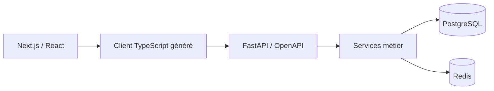

# The Masterz Gym · Plateforme de gestion

Un site public et une plateforme de gestion pour une salle de sport à Kénitra : adhésions, abonnements, réservations, présences et opérations de réception.

**Next.js · TypeScript · FastAPI · PostgreSQL · Redis · Docker**

## Le projet en pratique

- Site public et interfaces adaptées aux rôles membre, réception, coach et administration.
- Authentification JWT/OTP, demandes d'adhésion, formules, abonnements et renouvellements.
- Suivi des présences, paiements en réception, reçus et traces d'audit.
- Modules métier présents dans le dépôt pour les cours collectifs, le coaching, le recovery, la boutique, le café, les réclamations et les notifications.

Le périmètre évolue par phases. La présence d'un module dans le code ne signifie pas que tous ses parcours sont finalisés ; la [feuille de route](docs/PRODUCT_ROADMAP.md) distingue le travail prévu et les étapes du projet.

## Architecture

**Monolithe modulaire** dans un monorepo : les règles métier restent regroupées dans le backend, avec une séparation routeurs / services / repositories. Le contrat OpenAPI de FastAPI alimente le client TypeScript généré.



| Dossier | Contenu |
| --- | --- |
| `apps/web/` | Site et interfaces de gestion |
| `apps/api/` | Backend, migrations, seed et tests |
| `packages/` | Composants et code partagés |
| `docs/` | Spécification, phases et feuille de route |

## Démarrage local

Prérequis : Docker Desktop et Docker Compose. Pour les outils hors Docker : Node.js 20+, npm 10+ et Python 3.12+.

```powershell
git clone https://github.com/lahlouabdeslam6-rgb/the-masterz-gym.git
cd the-masterz-gym
Copy-Item .env.example .env
docker compose up -d --build
docker compose run --rm api alembic upgrade head
docker compose run --rm api python -m app.seed
```

Avec les ports de `.env.example` : site sur http://localhost:3000, documentation API sur http://localhost:8000/docs et santé sur http://localhost:8000/api/v1/health.

Le seed crée des comptes de démonstration strictement locaux, décrits dans le [guide de démarrage de la phase 2](docs/setup-phase-2.md). Les valeurs de développement doivent être remplacées pour tout autre environnement.

### Régénérer le client API

```powershell
npm install
npm run generate:api-client
```

Cette commande utilise le contrat `packages/api-client/openapi.json` versionné dans le dépôt. Actualiser ce contrat depuis le backend lorsque l'API évolue ; ne pas ajouter des routes supposées dans le frontend.

## Vérification

```powershell
cd apps/api
python -m pip install -e ".[dev]"
pytest
ruff check .
ruff format --check .
cd ../..
npm run lint:web
npm run build:web
```

Les tests d'intégration nécessitent l'environnement de données configuré. Ces commandes décrivent les contrôles du dépôt, sans constituer une promesse de validation en production.

## Documentation

- [Spécification du projet](docs/PROJECT_SPEC.md)
- [Phase 2 : parcours et commandes](docs/PHASE_2.md)
- [Feuille de route](docs/PRODUCT_ROADMAP.md)

**Auteur : [Ismail Lahlou](https://github.com/lahlouabdeslam6-rgb)** · [Portfolio](https://portfolio-ismail-lahlou.alvarezvcarlosr44274.chatgpt.site/)
